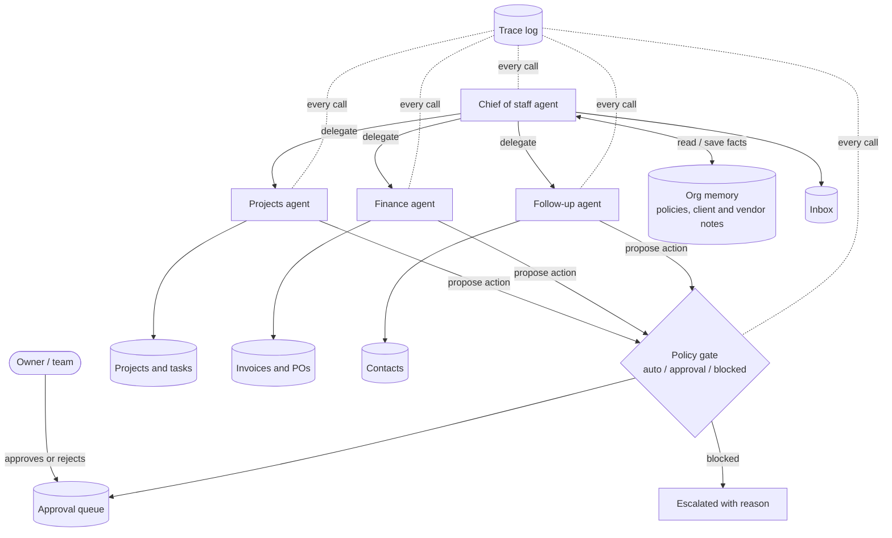

# ops-chief

An AI chief of staff for a project-based business. Every morning it reads the inbox, checks the company's rules, and delegates to specialist agents that find stalled work, check invoices against purchase orders, and draft the follow-ups that move things forward. People approve anything that leaves the building or moves money.

The demo company is fictional: **Harbor & Pine Builders**, a small construction firm with three projects, a few subcontractors, open invoices and a messy week.

```
$ python -m ops_chief run --offline --fresh

Owner brief

Needs your decision today: 6 item(s) in the approval queue (4 email drafts, 2 payments).
Held by policy: 1 action(s). Invoice 19950.00 does not match PO 18400.00 within 2%.
Issues found: 8, 3 high priority:
  - T-201: 'Submit HVAC shop drawings' (Ridgeline Mechanical) is overdue.
  - T-202: 'Approve HVAC shop drawings' is blocked waiting on T-201 (Ridgeline Mechanical), which is 14 days without an update.
  - INV-9002: Ridgeline Concrete billed 19950.00 against PO 18400.00; extras need a change order.

Handled: stalled tasks marked, follow-ups drafted, and a note saved about Ridgeline Mechanical's delay.
```

## Architecture



**Hierarchy and delegation.** The chief of staff plans the day and hands each specialist one task. Specialists have their own system prompt and only the tools for their job (finance cannot draft email; follow-up cannot propose payments).

**Context engineering.** A specialist never sees the chief's conversation. It gets its task, today's date, and the memories retrieved for that task. Smaller context, fewer distractions, and no leaking of one area's data into another.

**Persistent memory and retrieval.** Policies, client preferences and vendor history live in a memory store that agents search by relevance. Agents can save new facts for future runs, but they cannot change a policy: only a person can.

**Approval gates in code, not in the prompt.** Agents only propose actions. `policy.py` decides: marking a task stalled happens automatically, every email and payment waits for a person, and an invoice that doesn't match its purchase order is blocked outright with the reason. A model that is confused, or talked into something by an email, still cannot get past the gate. The demo shows this on purpose: the finance agent tries to pay the over-billed invoice because the vendor's email explains the extra, and the gate holds it.

**Monitoring and tracing.** Every model call, tool call, delegation and gate decision is a span in a trace log with timing and token counts. `python -m ops_chief trace` prints the tree of the last run.

**Failure handling.** Model calls retry on rate limits and server errors, fall back to a second model, and stop using a model whose recent calls keep failing (circuit breaker). Refusals move to the fallback too. Tool errors go back to the agent as errors instead of crashing the run, and every agent has a step limit that escalates to a person instead of looping.

**Evaluation.** `python -m ops_chief eval` runs the review and checks what must always be true: no email or payment goes out unapproved, the over-billed invoice is held, the missed handoff is found, finished work is not flagged, the waiting client gets a reply, and no agent rewrote a policy.

## Run it

Requires Python 3.10+.

```bash
python -m venv .venv
source .venv/bin/activate          # Windows: .venv\Scripts\activate
pip install -e ".[dev]"

python -m ops_chief run --offline --fresh   # no API key needed
python -m ops_chief approvals               # the queue a person works through
python -m ops_chief approve 15              # approve item 15 (nothing is actually sent in the demo)
python -m ops_chief trace                   # what happened, step by step
python -m ops_chief eval                    # the evaluation checks
pytest                                      # 26 tests
```

With an Anthropic API key, drop `--offline` to run the same organization on Claude: the chief of staff on Claude Opus 5.5 and the specialists on Claude Haiku 5.5, each falling back to Claude Sonnet 5.5.

`--offline` swaps in a scripted model that calls the same tools in a sensible order, so the whole system (delegation, memory, gates, tracing, evals) runs and is tested without network access.

## Layout

```
ops_chief/
  agents.py    The four agents: prompts, tools, the agent loop, delegation
  policy.py    Approval gates: auto / approval / blocked, and the human decision
  memory.py    Org memory with relevance retrieval; policies are read-only to agents
  llm.py       Claude API with fallback, refusal handling and a circuit breaker; scripted stand-in
  tracing.py   Spans to a JSONL trace and a readable tree
  evals.py     Checks that must hold after every run
  scripted.py  Deterministic agent behaviour for the offline demo and tests
  db.py        SQLite store for the business data, issues and actions
data/seed.json Harbor & Pine Builders: projects, tasks, invoices, POs, inbox, memory
tests/
```

## What I'd add for a real business

- Connectors for the real systems (Gmail or Outlook, Google Calendar, the CRM, the project-management tool, the accounting system) behind the same tool interfaces, with OAuth and least-privilege scopes per agent.
- A small web page for the approval queue, with one-click approve, edit-then-approve and reject with a note that becomes memory.
- Scheduled runs and alerts when an agent errors, a gate blocks something important, or costs spike.
- More evaluation scenarios drawn from real weeks, run on every change to a prompt or a model.

Built with Claude Code as a coding assistant. I designed the architecture, the gates and the evaluation, and I review and test everything before it ships.
